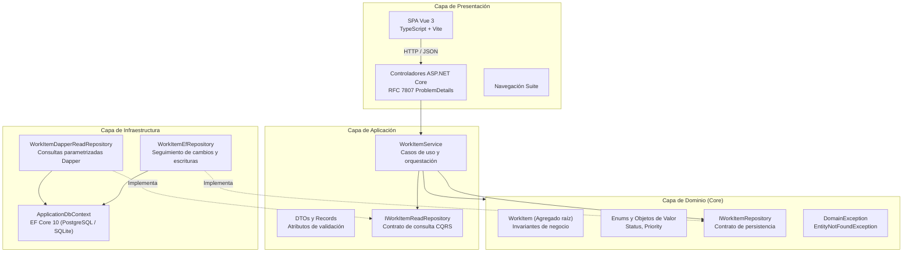

# Plantilla de inicio Full Stack con Clean Architecture (.NET 10 + Vue 3)

[](README.md)
[](#)
[](https://github.com/Nain9Dev/template-dotnet-clean-arch/actions/workflows/ci.yml)
[](https://dotnet.microsoft.com/)
[](https://vuejs.org/)
[](https://www.postgresql.org/)
[](#filosofía-de-cero-coste-facturable)

Plantilla de inicio full-stack de nivel empresarial construida con **.NET 10 Web API**, **Clean Architecture**, **Entity Framework Core 10** para mutaciones, **Dapper** para consultas de alto rendimiento y un cliente moderno en **Vue 3 + TypeScript**. Integrada en el ecosistema **NainDev** con soporte de alojamiento a coste cero.

---

## Arquitectura



## Stack tecnológico

- **Backend**: .NET 10 SDK, ASP.NET Core Web API (Controllers), EF Core 10 (Npgsql), Dapper 2.1, xUnit, FluentAssertions.
- **Frontend**: Vue 3.5 (Composition API con `<script setup>`), TypeScript estricto, Vite, Pinia, Axios.
- **Base de datos**: PostgreSQL 16 (producción con Docker Compose), SQLite en memoria (para pruebas rápidas de integración).
- **Contenedores**: Docker Compose para orquestación multi-servicio.

## Inicio rápido

### 1. Docker Compose (Recomendado)

```bash
docker compose up --build
```

- Frontend: <http://localhost:5173>
- Backend Swagger: <http://localhost:5000/swagger>
- Comprobación de salud: <http://localhost:5000/health>

### 2. Desarrollo local manual

**Backend**:
```bash
cd backend
dotnet restore template-dotnet-clean-arch.slnx
dotnet test template-dotnet-clean-arch.slnx
dotnet run --project src/Presentation/Template.Api
```

**Frontend**:
```bash
cd frontend
npm install
npm run dev
```

## Filosofía de cero coste facturable

Esta plantilla sigue las directrices del Engineering Handbook de NainDev:
- Demostración y pruebas locales mediante FOSS y recursos sin coste.
- Pruebas automatizadas en CI con GitHub Actions.
- Sin servicios cloud de pago vinculados por defecto.

## Licencia

Distribuido bajo la [Licencia MIT](LICENSE).
