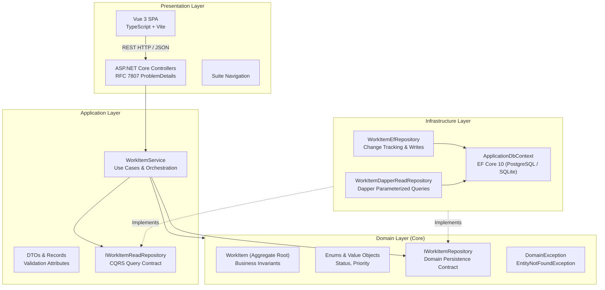

<picture>
  <source media="(prefers-color-scheme: dark)" srcset="docs/assets/banner-dark.svg">
  <source media="(prefers-color-scheme: light)" srcset="docs/assets/banner-light.svg">
  
</picture>

# Full Stack Clean Architecture Starter (.NET 10 + Vue 3)

[](#)
[](README.es.md)
[](https://github.com/Nain9Dev/template-dotnet-clean-arch/actions/workflows/ci.yml)
[](https://dotnet.microsoft.com/)
[](https://vuejs.org/)
[](https://www.postgresql.org/)
[](#zero-billable-cost-philosophy)

Enterprise-grade full-stack starter template built with **.NET 10 Web API**, **Clean Architecture**, **Entity Framework Core 10** for mutations, **Dapper** for high-throughput queries, and a modern **Vue 3 + TypeScript** client. Integrated into the **NainDev Ecosystem Suite** with zero-billable-cost hosting support.

---

## Architecture Overview



### Dependency Rule
- **Domain**: Pure business rules with zero dependencies on frameworks, databases, or third-party libraries.
- **Application**: Depends only on Domain. Exposes business contracts, DTOs, and use case orchestration.
- **Infrastructure**: Implements interfaces defined by Domain and Application using EF Core and Dapper.
- **Presentation**: ASP.NET Core controllers and the Vue 3 single page application.

---

## Persistence Strategy: EF Core Writes + Dapper Reads

| Operation Type | Tool | Rationale | Performance & Integrity |
| :--- | :--- | :--- | :--- |
| **Domain Mutations** | **EF Core 10** | Full change tracking, identity map, aggregate root lifecycle encapsulation, and schema migrations. | Transactional safety and zero risk of partial updates. |
| **High-Throughput Queries** | **Dapper** | Zero object allocation overhead, explicit SQL parameterization, and instant dictionary mapping. | Sub-millisecond latency for complex dashboards and listings. |

---

## Quickstart

### Option 1: Local Development (Instant SQLite Fallback)

1. **Backend**:
   ```bash
   cd backend
   dotnet run --project src/Presentation/Template.Api/Template.Api.csproj
   # Runs on http://localhost:5000 (OpenAPI doc at http://localhost:5000/openapi/v1.json)
   ```

2. **Frontend**:
   ```bash
   cd frontend
   npm install
   npm run dev
   # Accessible at http://localhost:5173
   ```

### Option 2: Docker Compose (PostgreSQL 16)

```bash
docker compose up --build
```
- Frontend client: `http://localhost:8080`
- API backend: `http://localhost:5000`
- PostgreSQL: `localhost:5432`

---

## API Reference

| Verb | Path | Description | Response |
| :--- | :--- | :--- | :--- |
| `GET` | `/api/v1/health` | Service health status check | `200 OK` |
| `GET` | `/api/v1/work-items` | List items (optional `?status=`) via Dapper | `200 OK` |
| `GET` | `/api/v1/work-items/{id}` | Retrieve single item by ID | `200 OK` / `404 ProblemDetails` |
| `POST` | `/api/v1/work-items` | Create new work item via EF Core | `201 Created` / `400 ProblemDetails` |
| `PUT` | `/api/v1/work-items/{id}` | Update title, description, priority | `200 OK` / `404 ProblemDetails` |
| `PATCH` | `/api/v1/work-items/{id}/status` | Transition item status | `200 OK` / `400 ProblemDetails` |
| `DELETE` | `/api/v1/work-items/{id}` | Delete item | `204 NoContent` / `404 ProblemDetails` |

---

## Quality & Verification Gates

```bash
# Run unit tests and integration tests
dotnet test backend/template-dotnet-clean-arch.slnx

# Run frontend type-check and production build
cd frontend && npm run build
```

Both tests run automatically on every pull request via centralized reusable workflows in `Nain9Dev/.github`.

---

## Zero Billable Cost Philosophy

This repository is designed to be hosted entirely within free-tier infrastructure:
- **Client**: Static export deployable to GitHub Pages, Cloudflare Pages, or Netlify at **0.00 €**.
- **API & DB**: Multi-stage Linux container runnable on free cloud instances or local container runtimes.
- **Observability**: Uptime monitoring integrated with [status.naindev.com](https://status.naindev.com/).

---

## License

MIT License. Free for personal and commercial projects.
